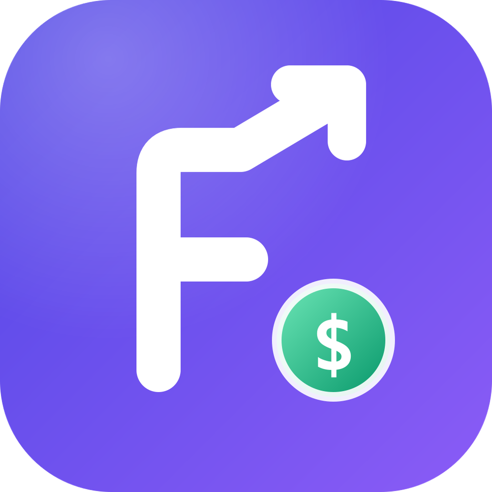

  
  <h1>Finza</h1>
  
Controla tu dinero, alcanza tus metas.

Finza es una app de finanzas personales para Colombia: ingresos, gastos,
cuentas y bolsillos, pagos recurrentes, y herramientas como el 4×1000, las
tasas de interés y la declaración de renta.

## Basada en Cashew

Finza es una versión modificada de [Cashew](https://github.com/jameskokoska/Cashew),
de James (dapperappdeveloper), publicada bajo la licencia GPL-3.0. Finza
mantiene esa misma licencia ([LICENSE](LICENSE)): cualquiera puede usar,
estudiar, modificar y redistribuir este código, siempre que lo comparta con la
misma licencia y con su código fuente.

Cambios frente a Cashew, desde noviembre de 2026:

- Nombre, logo y colores de Finza.
- Cuentas agrupadas según dónde está la plata (banco o efectivo), con
  bolsillos dentro, y una vista de los dispositivos que sincronizan por
  Google Drive.

El README original de Cashew está en [README-Cashew.md](README-Cashew.md).
